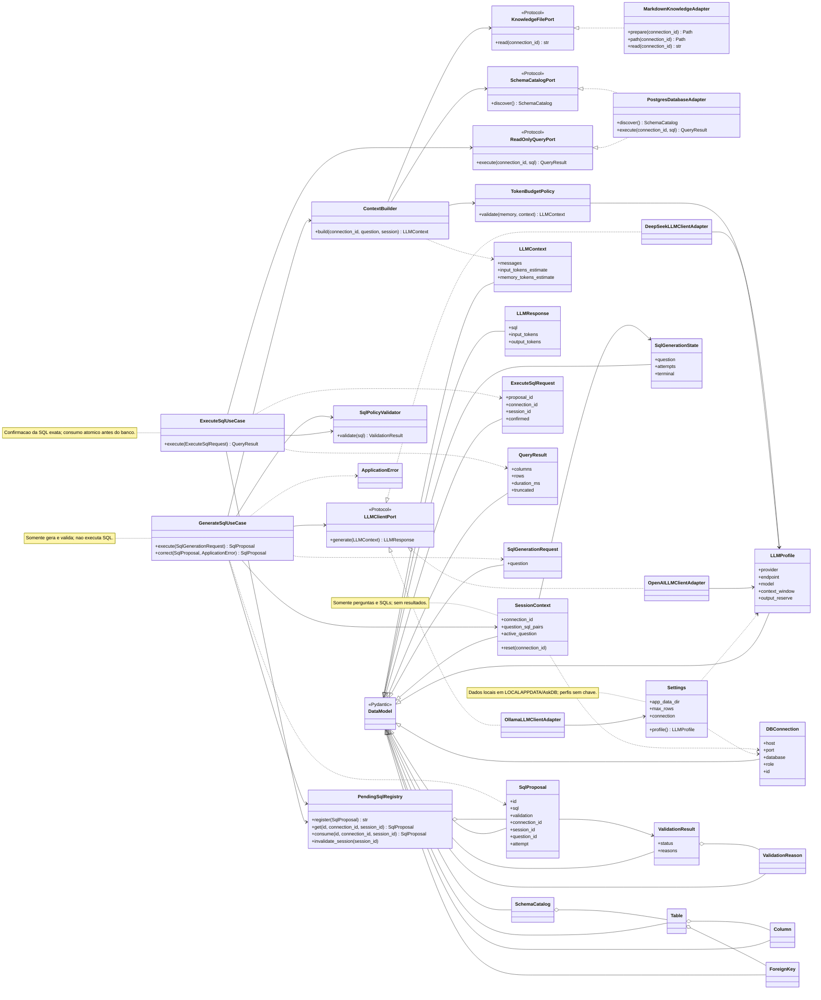

# AskDB

**Consulte bancos de dados PostgreSQL usando linguagem natural.**

Projeto de Trabalho de Conclusão de Curso (TCC) em Análise e Desenvolvimento de
Sistemas — Instituto Federal de São Paulo (IFSP), Câmpus Guarulhos.

## Estado do desenvolvimento

O backend da V0 está em implementação/verificação na branch `marco-2-v0`, partindo
de `marco-1-20-pct`. Oferece CLI com contexto de negócio por conexão, geração e
validação de SQL, confirmação explícita e execução restrita com saída tabular.
A API FastAPI mantém geração/validação e Swagger, sem endpoint de execução.

DeepSeek BYOK é a integração remota prioritária; Ollama e OpenAI usam o mesmo
contrato. As provas reais e simuladas, pendências e limites estão em
[backend/evidencias-v0.md](backend/evidencias-v0.md). Disponibilidade de um
adaptador não significa que uma chamada real com chave já tenha sido validada.

Veja [as instruções do backend](backend/README.md) para instalação, configuração,
pasta local, seleção de provedor, CLI, Swagger e testes reproduzíveis.

## Fluxo da V0

Pergunta → esquema autorizado + contexto da conexão → geração → validação →
apresentação da SQL e destino → confirmação explícita → revalidação → execução
PostgreSQL somente leitura → resultado tabular local.

- Um `context.md` por conexão em `%LOCALAPPDATA%\AskDB\connections\<id>\context.md`.
- Até três tentativas totais por pergunta, sem correção para contornar bloqueios.
- Chave do provedor em tempo de execução, sem gravação pela aplicação.
- Timeout de 30 segundos e limite de resultado, com respeito à role e ao RLS.
- Resultados não são reenviados ao modelo nem usados como memória.

O projeto usa Python 3.11+, FastAPI, Pydantic, SQLGlot, psycopg, httpx e pytest,
com PostgreSQL sintético reproduzível por Docker Compose. O núcleo não depende
de um fornecedor de IA nem de uma interface gráfica.

## Evolução prevista

A V1 é o MVP desktop com Electron/React/TypeScript/Vite, SQLite dedicado a
configurações e conversas, entrevista para conhecimento validado por conexão,
proteção opcional de segredos e Control Plane básico. O SQLite referenciará o
arquivo Markdown por conexão; o texto de negócio continuará no arquivo.
V2 e V3 são possibilidades posteriores de explicação e visualização.

As definições OpenSpec são mantidas localmente e ignoradas pelo Git. A documentação
acadêmica está na branch `docs/relatorio-tecnico`; sua modelagem conceitual orienta
responsabilidades e não exige replicar todas as assinaturas do código.

## Diagrama de classes do backend V0

O arquivo editável está em [assets/diagrama-classes.mmd](assets/diagrama-classes.mmd).
O diagrama abaixo representa os tipos implementados, incluindo interfaces e
modelos de dados. Classes de frameworks e funções auxiliares foram resumidas.

