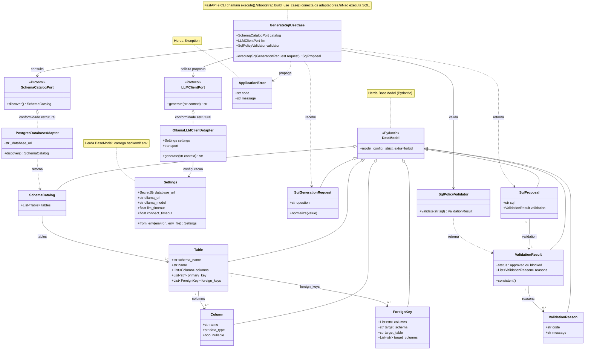

# AskDB

**Consulte bancos de dados usando linguagem natural.**

O AskDB é um projeto de Trabalho de Conclusão de Curso (TCC) do curso de Análise e Desenvolvimento de Sistemas do Instituto Federal de São Paulo (IFSP) — Câmpus Guarulhos.

O projeto propõe uma aplicação desktop que utiliza Inteligência Artificial (IA) e Processamento de Linguagem Natural (PLN) para permitir que usuários consultem bancos de dados PostgreSQL por meio de perguntas em português, sem precisar escrever comandos SQL manualmente.

## Objetivo

Simplificar o acesso aos dados, permitindo que usuários sem conhecimento técnico em SQL obtenham informações por meio de perguntas em linguagem natural, com mecanismos de validação e segurança antes da execução das consultas.

## Funcionalidades previstas

- Configuração de conexão com bancos de dados PostgreSQL.
- Identificação automática da estrutura do banco de dados.
- Formulação de perguntas em linguagem natural.
- Geração de consultas SQL com auxílio de IA.
- Validação das consultas antes da execução.
- Restrição da execução a consultas de leitura autorizadas.
- Apresentação dos resultados em tabelas.
- Tratamento controlado de erros e tentativas de correção de consultas.

## Tecnologias previstas

**Backend**
- Python
- FastAPI
- SQLAlchemy
- Pydantic

**Frontend e aplicação desktop**
- React
- TypeScript
- Vite
- Electron

**Banco de dados**
- PostgreSQL

**Inteligência Artificial**
- Integração com modelos de linguagem para geração de SQL.

## Segurança

O AskDB será desenvolvido com foco na execução controlada de consultas. A aplicação deverá validar as instruções geradas e impedir operações de escrita ou alteração estrutural do banco de dados.

A utilização de amostras de registros como contexto para a IA dependerá de autorização explícita do usuário.

## Status do projeto

O backend do marco de 20% está disponível na branch `marco-1-20-pct`.
Consulte [as instruções do backend](backend/README.md) para o estado da implementação,
instalação, configuração e testes. As funcionalidades de produto descritas acima
incluem evoluções planejadas e não representam integralmente a entrega atual.

Em desenvolvimento.

As funcionalidades descritas representam o escopo planejado e poderão ser ajustadas durante a implementação e avaliação acadêmica.

## Diagrama de classes do backend

O diagrama representa as classes implementadas no marco de 20%, com os principais
atributos, operações e relacionamentos. O arquivo editável está em
[assets/diagrama-classes.mmd](assets/diagrama-classes.mmd) e usa Mermaid, renderizado
pelo GitHub no bloco abaixo.

### Componentes principais

| Componente | Responsabilidade atual |
|---|---|
| `GenerateSqlUseCase` | Coordena a descoberta do esquema, a chamada ao modelo e a validação da proposta; não executa SQL. |
| `SchemaCatalogPort` e `PostgresDatabaseAdapter` | Definem e implementam a descoberta do catálogo autorizado do PostgreSQL. |
| `LLMClientPort` e `OllamaLLMClientAdapter` | Definem o contrato de geração e sua integração com o Ollama local. |
| `SqlPolicyValidator` | Avalia a estrutura SQL e retorna aprovação ou bloqueio com motivos. |
| `SqlGenerationRequest`, `SqlProposal`, `ValidationResult` e `ValidationReason` | Representam a pergunta, a SQL proposta e a decisão da política. |
| `SchemaCatalog`, `Table`, `Column` e `ForeignKey` | Representam tabelas, colunas, tipos, chaves primárias e relacionamentos descobertos. |
| `DataModel` | Base Pydantic compartilhada pelos modelos de dados, com validação estrita e rejeição de campos extras. |
| `Settings` | Carrega a configuração do `.env` e do ambiente, incluindo conexão, modelo e limites de tempo. |
| `ApplicationError` | Transporta códigos e mensagens controladas de falhas da aplicação. |

As setas contínuas indicam associações; as tracejadas, dependências. Triângulos
contínuos indicam herança. A realização tracejada dos `Protocol` representa
conformidade estrutural: os adaptadores cumprem o contrato sem herdar
explicitamente dessas portas.

FastAPI e CLI são módulos com funções, não classes. Ambos usam o mesmo
`GenerateSqlUseCase`; a função `bootstrap.build_use_case()` compõe suas
dependências. Classes externas de frameworks e métodos auxiliares foram
resumidos para manter o foco nos componentes do projeto.

## Contexto acadêmico

Projeto desenvolvido como Trabalho de Conclusão de Curso (TCC) em Análise e Desenvolvimento de Sistemas — IFSP, Câmpus Guarulhos.
